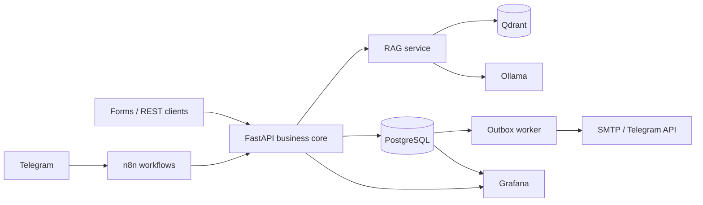

# Rentkom Smart Enterprise

**Real-estate workflow automation, notification delivery, and document-based RAG**

[](https://github.com/Eclipse-XS/rentkom-smart-enterprise/actions/workflows/ci.yml)
[](https://www.python.org/)
[](LICENSE)

Rentkom is a local, reproducible demonstration of business workflows for a real-estate agency. It receives consultation requests and feedback, records business events in PostgreSQL, coordinates automations with n8n, and provides document-based question answering through Qdrant and Ollama. Grafana shows business activity and notification-delivery diagnostics.

**Project scope:** An educational and portfolio application using demonstration data. It is not a deployed agency service, a verified legal-information source, or a substitute for professional legal advice.

## What it does

| Area | Implementation |
| --- | --- |
| Client requests | FastAPI intake, phone normalization, customer deduplication, request status history, and audit events |
| Notifications | PostgreSQL transactional outbox, retry handling, and optional SMTP/Telegram delivery |
| Automation | n8n workflows for Telegram routing, forms, feedback, and supporting integrations |
| Document Q&A | Retrieval from six demonstration documents using Qdrant embeddings and Ollama generation |
| Monitoring | Three versioned Grafana dashboards with 26 panels across business metrics, feedback, and delivery health |

The notification outbox provides **at-least-once delivery**, not an exactly-once guarantee. The RAG assistant is evaluated on a limited test dataset; evaluation scores are not guarantees about unseen questions.

## Architecture



The FastAPI layer owns request validation and business logic. PostgreSQL stores business records, audit events, and notification state. n8n orchestrates external workflows. Grafana reads relational data and protected API telemetry.

## Run the local demo

Requirements: Docker Engine with Docker Compose v2. Run commands from the repository root.

```bash
cp .env.example .env
docker compose --profile demo up -d --build
docker compose exec business-api python tools/seed_demo_data.py
```

| Local interface | Address |
| --- | --- |
| FastAPI / Swagger | http://127.0.0.1:8000/docs |
| API liveness | http://127.0.0.1:8000/api/v1/health/live |
| API readiness | http://127.0.0.1:8000/api/v1/health/ready |
| Grafana | http://127.0.0.1:3000 |
| Qdrant dashboard | http://127.0.0.1:6333/dashboard |

The `demo` profile does **not** start n8n or Ollama, and therefore does not represent a full connected Telegram or RAG demonstration. It uses local/mock notification behavior. The values in `.env.example` are for local demonstration only; replace credentials before exposing any service beyond localhost.

Additional Compose profiles:

| Profile | Purpose | Important condition |
| --- | --- | --- |
| `demo` | API, PostgreSQL, Qdrant, Grafana | No external provider credentials required |
| `connected` | Adds n8n | Configure strong API keys and external integration credentials; set `ENVIRONMENT=connected` |
| `full-ai` | Adds n8n and Ollama | Models and the Qdrant knowledge-base index require initialization |
| `dedicated-worker` | Runs a separate notification worker | Set `RUN_OUTBOX_WORKER_IN_LIFESPAN=false` to disable the API lifespan worker |

For connected configuration, deployment steps, and recovery commands, see [DEPLOYMENT.md](DEPLOYMENT.md).

## RAG evaluation

The repository contains a [30-question benchmark](evaluation/rag_eval_dataset.json) and its [recorded result](evaluation/rag_eval_results.json), dated **4 November 2026**. These results describe a specific local inference run, not a continuously monitored production system.

| Metric | Recorded value | Interpretation |
| --- | ---: | --- |
| Recall@K | 95.0% | Expected-source retrieval on the benchmark |
| Full multi-document coverage | 80.0% | Multi-source questions with all expected sources retrieved |
| Factual claim accuracy | 80.0% | Heuristic claim-match proxy, not independent fact verification |
| Abstention accuracy | 100% | Correct refusal on the benchmark's out-of-scope set |
| Citation support proxy | 94.74% | Heuristic source-alignment measure, not formal entailment proof |
| p50 / p95 response time | 32.191 / 74.635 s | Local benchmark inference latency |

The benchmark is small and task-specific. The assistant can still omit details or provide unsupported statements. See [evaluation methodology](docs/audit/RAG_EVALUATION.md) and [known risks](docs/audit/REMAINING_RISKS.md).

## Repository layout

```text
core/                      FastAPI routes, business services, security, data models
SMART_ENTERPRISE/
  ai/knowledge_base/source/ Six demonstration PDF/DOCX documents
  automation/n8n/          Eight workflow JSON definitions
  database/                SQL initialization, migration, and checks
  monitoring/              Grafana dashboards and provisioning
scripts/                   Environment and integration setup utilities
tools/                     Data seeding, evaluation, backup, and maintenance
evaluation/                RAG benchmark inputs and recorded outputs
tests/                     Unit, security, integration, and end-to-end tests
docs/audit/                Historical engineering and evaluation evidence
compose.yaml               Docker Compose services and profiles
DEPLOYMENT.md              Environment setup and operational procedures
```

The database bootstrap defines **nine tables**, including `inbound_lead_submissions`, plus compatibility and analytics views. Grafana includes [business analytics (10 panels)](SMART_ENTERPRISE/monitoring/dashboards/business_analytics.json), [legacy real-estate monitoring (5)](SMART_ENTERPRISE/monitoring/dashboards/real_estate_monitoring.json), and [technical observability (11)](SMART_ENTERPRISE/monitoring/dashboards/technical_observability.json).

## Tests and limitations

```bash
python -m pytest tests/unit tests/security -v --tb=short
docker compose --profile demo config --quiet
```

Integration and end-to-end tests may require an isolated PostgreSQL test database or running external services. The GitHub Actions workflow also checks container configuration, workflow contracts, and selected integration scenarios. See [.github/workflows/ci.yml](.github/workflows/ci.yml).

Current boundaries:

- Real Telegram delivery and corporate SMTP require valid provider credentials; local contract tests do not replace live external delivery evidence.
- CPU-based RAG inference has high measured latency and is not suitable for latency-sensitive deployment without further testing.
- Document-based responses are informational only and must not be used as verified legal advice.
- The public API rate limiter is in-memory; horizontal scaling would require shared rate-limit state or an external gateway.
- Historical audit reports describe verification at particular commits and dates. They are not a perpetual release approval.

## Documentation and license

- [Deployment and configuration](DEPLOYMENT.md)
- [Database schema guide](SMART_ENTERPRISE/database/README.md)
- [Grafana dashboard guide](SMART_ENTERPRISE/monitoring/README.md)
- [Recorded RAG evaluation](docs/audit/RAG_EVALUATION.md)
- [Operational risks](docs/audit/REMAINING_RISKS.md)
- [MIT License](LICENSE)
