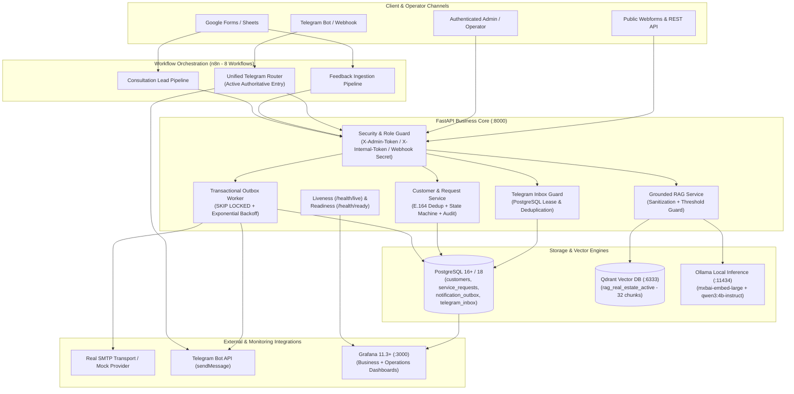

# Rentkom Smart Enterprise: Automated Real Estate Operations & RAG Platform

[](https://github.com/Eclipse-XS/rentkom-smart-enterprise/actions)
[](LICENSE)
[](https://www.python.org/downloads/)
[](https://fastapi.tiangolo.com)
[](https://www.postgresql.org/)
[](https://n8n.io/)
[](https://qdrant.tech/)
[](https://ollama.com/)
[](https://grafana.com/)

A modern, production-grade enterprise automation platform and AI knowledge system for real estate operations (**Rentkom Agency, Lviv**). Engineered with an asynchronous **FastAPI Business Core**, **PostgreSQL transactional outbox & idempotency engine**, **n8n event-driven workflow orchestrator**, **grounded RAG procedural assistant** (Qdrant + Ollama), and a dual **Grafana observability stack**.

---

## 1. Executive Summary

Real estate agencies process multi-channel client inquiries across property purchases, leases, landlord onboarding, and post-consultation feedback. Fragmented spreadsheets and synchronous scripts lead to duplicate client profiles, lost consultation leads during provider outages, unverified automated answers, and unmonitored backlogs.

**Rentkom Smart Enterprise** solves these operational bottlenecks through a unified, transactionally consistent architecture:
- **Zero-Loss Lead Ingestion**: Idempotent request intake (`source_row_id` conflict detection) and E.164 phone customer deduplication protected by PostgreSQL constraints and `SAVEPOINT` collision recovery.
- **Transactional Outbox Delivery**: Atomic persistence of business records (`service_requests`), audit trail (`audit_events`), and notification intents (`notification_outbox`), processed asynchronously with `SELECT ... FOR UPDATE SKIP LOCKED`, exponential backoff, and real SMTP / Telegram transports.
- **Strictly Grounded RAG Consultant**: Local vector search over 6 official agency regulatory documents in Qdrant with Ollama (`mxbai-embed-large` + `qwen3:4b-instruct`), enforcing strict evidence thresholds, indirect prompt-injection sanitization, and informational-only disclaimers.
- **End-to-End Observability**: Two pre-provisioned Grafana dashboards (19 panels total) backed by PostgreSQL views and FastAPI JSON telemetry endpoints.

---

## 2. Business Problem

1. **Multi-Channel Lead Fragmentation**: Inquiries arrive from web forms, Google Forms/Sheets, and Telegram, often containing variant phone formats (`067...`, `38067...`, `+38 (067)...`) that create duplicate customer records.
2. **Brittle Notification Dispatch**: Sending emails or Telegram alerts directly inside HTTP request handlers causes request failures or silent drops whenever SMTP or Telegram APIs experience transient errors or rate limits.
3. **Duplicate Webhook Delivery**: Telegram and n8n webhook retries can trigger duplicate bot responses or double-insert client records without a persistent database lease guard.
4. **Unverified AI Legal Advice**: Unconstrained LLM chatbots risk hallucinating Ukrainian civil code articles or acting as unlicensed legal counsel.

---

## 3. System Architecture



---

## 4. Service Inventory

| Service | Container / Process | Default Port | Profile(s) | Role |
|---|---|---:|---|---|
| **PostgreSQL** | `rentkom-postgres` (`postgres:16-alpine`) | `5432` | `demo`, `connected`, `full-ai` | Primary ACID relational database, legacy compatibility views, outbox & inbox tables |
| **Business Core API** | `rentkom-business-api` (FastAPI / Uvicorn) | `8000` | `demo`, `connected`, `full-ai` | REST API, security enforcement, customer deduplication, state machine, RAG service |
| **Outbox Worker** | `rentkom-outbox-worker` | — | `dedicated-worker` (or in-lifespan) | Polls `notification_outbox` using `FOR UPDATE SKIP LOCKED` and dispatches notifications |
| **Qdrant** | `rentkom-qdrant` (`qdrant/qdrant:v1.12.1`) | `6333` | `demo`, `connected`, `full-ai` | Vector similarity index storing 32 deterministic chunks across 6 agency documents |
| **Grafana** | `rentkom-grafana` (`grafana/grafana:11.3.0`) | `3000` | `demo`, `connected`, `full-ai` | Pre-provisioned Business Analytics (13 panels) & Operations Monitoring (6 panels) |
| **n8n** | `rentkom-n8n` (`rentkom/n8n:2.46.5-brotli1.2.1`) | `5678` | `connected`, `full-ai` | n8n 2.46.5 on the exact upstream digest, with the native Alpine Brotli package reproducibly upgraded to `1.2.1-r0` |
| **Ollama** | `rentkom-ollama` (`ollama/ollama:latest`) | `11434` | `full-ai` (or host native) | Local embedding (`mxbai-embed-large`) and chat generation (`qwen3:4b-instruct-2507-q4_K_M`) |

Customer feedback ownership is intentionally one-way: LR3 writes responses to Google Sheets, and LR5 reads that sheet to calculate Grafana CSAT metrics. The legacy PostgreSQL `customer_feedback` API remains available for compatibility but is not the source for LR5 panels. Connected LR3/LR4/LR5 operation requires the existing n8n Google OAuth credentials to remain authorized; reconciliation preserves credential IDs and encrypted token data but cannot replace interactive Google consent. On Windows, the supported RAG deployment may use the host Ollama service through `host.docker.internal`, retaining CPU fallback when GPU acceleration is unavailable.

---

## 5. Execution Modes (`demo` vs `connected` vs `full-ai`)

| Capability | `demo` Mode | `connected` Mode | `full-ai` / `production` Mode |
|---|---|---|---|
| **External Secrets Required** | None (uses safe local defaults) | `ADMIN_API_KEY`, `INTERNAL_API_KEY`, `TELEGRAM_BOT_TOKEN`, `TELEGRAM_SECRET_TOKEN`, SMTP | Strong keys (>=24 chars) enforced at startup (`validate_runtime_security()`) |
| **Notification Transport** | `NOTIFICATION_PROVIDER=mock` (`MOCK_DELIVERED`) | `NOTIFICATION_PROVIDER=smtp` (`PROVIDER_ACCEPTED`) | `NOTIFICATION_PROVIDER=smtp` (`mock` rejected in `production`) |
| **Telegram Mock Endpoints** | Enabled (`/webhook-mock`, `/mock-dispatcher`) | Disabled (`HTTP 403 Forbidden`) | Disabled (`HTTP 403 Forbidden`) |
| **Telegram Outbound Dispatch** | Routes to `/api/v1/telegram/mock-dispatcher` | Routes to `/api/v1/telegram/send-message` (official Telegram Bot API) | Routes to `/api/v1/telegram/send-message` |

---

## 6. Quickstart (Demo Mode)

### Option A: Docker Compose
```bash
cp .env.example .env
docker compose --profile demo up -d --build
docker compose exec business-api python tools/seed_demo_data.py
```

### Option B: Local Standalone Python
```bash
python -m venv .venv
# Windows: .venv\Scripts\activate | Linux/macOS: source .venv/bin/activate
pip install -r requirements.txt
cp .env.example .env

python tools/seed_demo_data.py
python tools/manage.py up
```
- **Swagger UI:** `http://127.0.0.1:8000/docs`
- **Liveness Probe:** `http://127.0.0.1:8000/api/v1/health/live`
- **Readiness Probe:** `http://127.0.0.1:8000/api/v1/health/ready`

---

## 7. Connected Mode Setup

1. Configure `.env` with non-default secrets (`ENVIRONMENT=connected`, `ADMIN_API_KEY`, `INTERNAL_API_KEY`, `TELEGRAM_BOT_TOKEN`, `TELEGRAM_SECRET_TOKEN`, `TELEGRAM_ADMIN_CHAT_ID`, and `SMTP_*` settings).
2. Bootstrap n8n credentials safely without committing secrets:
   ```bash
   python scripts/bootstrap_n8n_credentials.py
   ```
3. Launch the `connected` or `full-ai` stack:
   ```bash
   docker compose --profile connected up -d --build
   ```

---

## 8. API Reference

| Method & Path | Access Policy | Description |
|---|---|---|
| `POST /api/v1/requests/` | Public (202 Acknowledgment) / Admin (201 Created) | Submit consultation request. Anonymous requests return 202 with opaque submission_id and no customer PII (SEC-01/02); authenticated admin requests return 201 with full ServiceRequestResponse |
| `GET /api/v1/leads/` | Admin (`X-Admin-Token` / `Bearer`) | Review unverified inbound lead submissions staged for operator review |
| `POST /api/v1/leads/{id}/promote` | Admin (`X-Admin-Token` / `Bearer`) | Atomically promote an unverified lead into verified customer & business request workflow with audit |
| `GET /api/v1/requests/` | Admin (`X-Admin-Token` / `Bearer`) | List customer consultation requests |
| `GET /api/v1/requests/{id}` | Admin (`X-Admin-Token` / `Bearer`) | Retrieve single consultation request by ID |
| `PATCH /api/v1/requests/{id}/status` | Admin (`X-Admin-Token` / `Bearer`) | Transition request state (`NEW` -> `IN_REVIEW` -> `SCHEDULED` -> `COMPLETED` / `CANCELLED`) with actor audit & CAS conflict detection |
| `POST /api/v1/feedbacks/` | Public (Validated) | Submit post-service customer rating (1–5) and feedback text |
| `GET /api/v1/feedbacks/` | Admin (`X-Admin-Token` / `Bearer`) | List customer feedback entries |
| `GET /api/v1/notifications/outbox` | Admin (`X-Admin-Token` / `Bearer`) | Inspect transactional outbox queue and delivery states |
| `POST /api/v1/notifications/process` | Internal or Admin (`X-Internal-Token` / `X-Admin-Token`) | Trigger transactional outbox batch processing |
| `POST /api/v1/telegram/webhook` | Telegram Secret (`X-Telegram-Bot-Api-Secret-Token`) or Internal | Production Telegram webhook ingress (rate-limited, verified) |
| `POST /api/v1/telegram/webhook-mock` | Demo/Test Mode Only | Simulated Telegram router endpoint (`403` in `connected`/`production`) |
| `POST /api/v1/telegram/inbox/guard` | `X-Internal-Token` (or `X-Test-Token` when `is_test=true` in demo) | Acquire atomic idempotency lease in `telegram_inbox` |
| `POST /api/v1/telegram/inbox/complete` | `X-Internal-Token` (or `X-Test-Token` in demo) | Mark `telegram_inbox` update `COMPLETED` and cache response |
| `POST /api/v1/telegram/mock-dispatcher` | Demo/Test Mode Only (`X-Test-Token` / `X-Internal-Token`) | Deterministic simulated Telegram message sink |
| `POST /api/v1/telegram/send-message` | Internal (`X-Internal-Token`), `is_test=false` | Dispatch live message via official Telegram Bot API |
| `POST /api/v1/rag/ask` | Public (Bounded & Sanitized) | Query grounded RAG assistant over agency documents with K=12 multi-doc diversified retrieval |
| `GET /api/v1/analytics/summary` | Admin / Internal (`X-Admin-Token` / `X-Internal-Token`) | Protected operational metrics for Grafana dashboard |
| `GET /api/v1/health`, `/health/live`, `/health/ready` | Public | Operational health, liveness (`200`), and DB readiness (`200`/`503`) |

---

## 9. Database Architecture & Migrations

- **Bootstrap Schema (`SMART_ENTERPRISE/database/init_db.sql`)**: Creates all 8 v2 tables (`customers`, `service_requests`, `request_status_history`, `customer_feedbacks`, `notification_outbox`, `notification_attempts`, `audit_events`, `telegram_inbox`), analytical views (`v_requests_analytics`, `v_feedback_analytics`, `v_outbox_telemetry`), and the backward-compatible legacy view `real_estate_requests` with its `INSTEAD OF INSERT` trigger (`insert_real_estate_request_legacy()`).
- **Idempotent Migration (`SMART_ENTERPRISE/database/schema_v2.sql`)**: Safely migrates legacy `real_estate_requests` tables into normalized v2 tables using `SELECT DISTINCT ON (phone)` customer deduplication and `ON CONFLICT (source_row_id) DO NOTHING`, and can be re-executed repeatedly with zero errors.

---

## 10. Notification Outbox Lifecycle

1. **Enqueue (`PENDING`)**: Created inside the same database transaction as `ServiceRequest`.
2. **Claim (`PROCESSING`)**: Claimed atomically via `SELECT ... FOR UPDATE SKIP LOCKED` and compare-and-swap update with a 300-second lease timeout.
3. **Dispatch**:
   - `mock` mode: Transitions to `MOCK_DELIVERED`.
   - `smtp` mode: Connects via `SMTPTransportAdapter` (`smtplib.SMTP`, STARTTLS, login, `sendmail`) and transitions to `PROVIDER_ACCEPTED` on HTTP/SMTP `250`.
4. **Retry & Recovery**: Transient errors (`421`, `451`, timeouts, connection refused) increment `retry_count`, record a `NotificationAttempt` row, and schedule `next_retry_at` using exponential backoff ($10\text{s} \times 2^{\text{retry\_count}-1}$). Crashed workers in `PROCESSING` past the lease window are automatically reclaimed.
5. **Dead-Letter (`FAILED` / `FAILED_PERMANENT`)**: Reached when `retry_count >= max_retries` (default 5).

---

## 11. Telegram & n8n Workflows

All 8 workflow definitions in `SMART_ENTERPRISE/automation/n8n/` are validated by automated contract tests (`tests/unit/test_n8n_workflows_contract.py`):
- **Single Active Telegram Entrypoint**: `unified_telegram_router.json` (`active: true`) is the sole active Telegram router. Legacy/auxiliary Telegram workflows (`telegram_bot.json`, `ai_agent_rag.json`) have `active: false` to prevent webhook polling conflicts.
- **Container-Ready Networking**: All workflows use `$env.BUSINESS_API_URL || 'http://business-api:8000'` and `$env.OLLAMA_BASE_URL || 'http://ollama:11434'` with zero hardcoded `127.0.0.1` URLs.
- **Explicit Demo vs. Connected Dispatch**: `unified_telegram_router.json` routes test webhook traffic (`is_test=true`) to `/api/v1/telegram/mock-dispatcher` and live traffic (`is_test=false`) to `/api/v1/telegram/send-message`.

---

## 12. RAG Architecture & Evaluation

- **Knowledge Base**: 6 source documents in `SMART_ENTERPRISE/ai/knowledge_base/source/` (`Керівництво_з_перевірки_документів.pdf`, `Опис_послуг_агентства.docx`, `Памятка_для_покупця.pdf`, `Порядок_підписання_договору.docx`, `Правила_конфіденційності.pdf`, `Шаблон_договору_оренди.docx`), indexed via `tools/reindex_knowledge_base.py` into 32 deterministic UUIDv5 chunks in Qdrant (`rag_real_estate_active`).
- **Strict Grounding & Safety**:
  - `mode="grounded"` is returned **if and only if** Qdrant retrieval succeeds, at least one chunk meets `RAG_MIN_SIMILARITY` (`0.55`), and Ollama generation succeeds.
  - `confidence_score` is the exact rounded maximum cosine similarity score from Qdrant (`0.0` on abstention, `None` on service fallback).
  - Retrieved chunks are sanitized via `sanitize_retrieved_chunk()` and wrapped in `<retrieved_evidence>` untrusted data delimiters.
  - The system prompt explicitly prohibits unlicensed legal representation and includes an informational consultant disclaimer.
- **30-Question Benchmark (`evaluation/rag_eval_dataset.json` & `evaluation/rag_eval_results.json`)**:
  - **Recall@K (20 in-domain questions):** `0.9500` (95.0% expected-source recall; 93.33% single-doc, 80.0% multi-doc full coverage)
  - **Factual Claim Accuracy (Heuristic Proxy):** `0.8000` (80.0% — 16/20 verified against reference claim anchors on un-truncated full text; Q05, Q08, Q15, Q22 missed)
  - **Abstention Accuracy (10 out-of-domain & adversarial questions):** `1.0000` (10/10 rejected)
  - **Unnecessary Abstention Rate:** `0.0500` (1/20 questions: Q22)
  - **Unsupported Answer Rate:** `0.0333` (3.33%).
  - **Citation Entailment Proxy:** `0.9474` (94.74%; heuristic source/citation proxy, not factual entailment proof).
  - **Latency/quality trade-off:** quality improved from 20% to 80% multi-document coverage, 85% to 95% Recall@K, and 73.68% to 94.74% citation proxy, while local CPU p95 increased from `34.489s` to `74.635s` (`p50 = 32.191s`).
  - **Evaluation Cache Safety:** Fresh live execution is default (`reuse_existing_responses=False`); full answers and citation objects preserved; legacy or incompatible cache strictly rejected with `IncompatibleCacheError`.

---

## 13. Monitoring & Grafana Dashboards

Grafana (`SMART_ENTERPRISE/monitoring/`) provisions two datasource integrations (`PostgreSQL Analytics DB` with UID `lab5-postgres` and `Rentkom Core API` with UID `rentkom-core-api`) and two dashboards:
1. **`real_estate_monitoring.json` (13 Panels)**: Total requests, conversion funnel, requests by status/purpose/property type, average service & realtor ratings, feedback trends, and outbox delivery distribution.
2. **`enterprise_observability.json` (6 Panels)**: API health status, outbox pending backlog, retry rate, and notification attempt telemetry.

---

## 14. Security Model

- **Authentication & Role Separation (`core/security.py`)**:
  - Administrative read/status endpoints require `X-Admin-Token` or `Authorization: Bearer <ADMIN_API_KEY>`.
  - Internal worker and n8n endpoints require `X-Internal-Token` or `ADMIN_API_KEY`.
  - Missing credentials return `HTTP 401 Unauthorized`; invalid credentials return `HTTP 403 Forbidden` using timing-safe `secrets.compare_digest`.
  - Unconfigured server keys fail closed with `HTTP 500` and never bypass authentication.
- **Test Database Protection (`tests/safety.py`)**: All destructive PostgreSQL fixtures require `TEST_DATABASE_URL` pointing to a database explicitly named with `test`, `disposable`, or `temp`, reject application/default databases (`postgres`, `rentkom`, `lab4_real_estate`), and verify/write the `_rentkom_test_safety_marker` table before dropping or truncating tables.

---

## 15. Testing Strategy & Commands

The current suite collects **194 tests** across unit, security, integration, and end-to-end layers. Tests requiring live n8n, PostgreSQL, Qdrant, Ollama, or external providers skip when those explicitly required resources are absent.

```bash
# 1. Run unit, security, and workflow contract tests:
pytest tests/unit -v --tb=short

# 2. Run SMTP transport & Telegram connected-mode contract tests:
pytest tests/integration/test_smtp_delivery.py tests/integration/test_telegram_connected_mode_contract.py -v --tb=short

# 3. Run the full suite including PostgreSQL integration, migrations, backup/restore, and live RAG:
# Set TEST_DATABASE_URL to an isolated disposable test database (must contain 'test', 'disposable', or 'temp'):
export TEST_DATABASE_URL="postgresql+psycopg2://postgres@127.0.0.1:5439/rentkom_test"
pytest tests/ -v --tb=short
```

---

## 16. Backup & Recovery

Logical PostgreSQL backup and safe disposable-database restore verification are provided by `tools/backup_restore.py` and `tools/manage.py`:

```bash
# Create logical backup via pg_dump:
python tools/manage.py backup --db-url "postgresql://postgres@127.0.0.1:5432/rentkom" --output-dir backups

# Verify restore into an isolated test database (protected by assert_safe_test_database):
python tools/manage.py restore --backup-file backups/rentkom_pg_backup_YYYYMMDD_HHMMSS.sql --target-db-url "postgresql://postgres@127.0.0.1:5439/rentkom_test"
```

---

## 17. Operational Boundaries & Known Limitations

1. **n8n image security**: `Dockerfile.n8n` derives from the exact official n8n 2.46.5 digest and upgrades only native `brotli-libs` to the vendor-fixed `1.2.1-r0`. Trivy 0.67.2 reports zero applicable unfixed CRITICAL OS or Node.js findings in the resulting image. CI rebuilds and scans this image without an ignore rule.
2. **External Provider Credentials**: Live Telegram Bot API (`sendMessage`) and commercial corporate SMTP relay delivery require user-supplied credentials in `.env` or a production vault. The local provider-compatible contract passes; external Telegram delivery remains BLOCKED when those credentials are absent.
3. **Local LLM CPU Latency**: The accepted quality improvements increased measured p95 from `34.489s` to `74.635s`. This is a documented performance regression; GPU acceleration and capacity testing remain deployment prerequisites for latency-sensitive production use.
4. **Public & RAG Rate Limiting**: Anonymous ingress (`POST /api/v1/requests/`, `POST /api/v1/feedbacks/`, 60 req/min) and neural RAG inference (`POST /api/v1/rag/ask`, 10 req/min) are protected by in-memory sliding-window rate limiters (HTTP 429). Client IP resolution enforces `TRUSTED_PROXIES` before honoring `X-Forwarded-For`. In multi-process horizontal deployments, Redis-backed rate limiting should be enabled in front of the platform.

---

## 18. Audit & Verification Reports

Detailed engineering acceptance evidence is maintained under [`docs/audit/`](docs/audit/):
- [`RECOVERY_BASELINE.md`](docs/audit/RECOVERY_BASELINE.md) — Pre-flight git, environment, and worktree baseline
- [`BASELINE_FINDINGS.md`](docs/audit/BASELINE_FINDINGS.md) — Initial defect inventory and root-cause analysis
- [`REMEDIATION_MATRIX.md`](docs/audit/REMEDIATION_MATRIX.md) — Complete defect-to-test remediation tracking matrix
- [`SECURITY_REVIEW.md`](docs/audit/SECURITY_REVIEW.md) — Endpoint authorization matrix, secret scan, and test safety review
- [`DATABASE_ACCEPTANCE.md`](docs/audit/DATABASE_ACCEPTANCE.md) — PostgreSQL 18 bootstrap, migration idempotency, concurrency, and backup/restore proof
- [`INTEGRATION_ACCEPTANCE.md`](docs/audit/INTEGRATION_ACCEPTANCE.md) — SMTP transport, Telegram connected mode, and n8n workflow contract verification
- [`RAG_EVALUATION.md`](docs/audit/RAG_EVALUATION.md) — 30-question live RAG evaluation metrics and grounding verification
- [`DOCKER_CLEANROOM_ACCEPTANCE.md`](docs/audit/DOCKER_CLEANROOM_ACCEPTANCE.md) — Docker Compose profile validation and host daemon status
- [`TEST_EVIDENCE.md`](docs/audit/TEST_EVIDENCE.md) — Full test execution logs and assertion inventory
- [`REMAINING_RISKS.md`](docs/audit/REMAINING_RISKS.md) — Residual operational risks and mitigations
- [`FINAL_DEFECT_ACCEPTANCE.md`](docs/audit/FINAL_DEFECT_ACCEPTANCE.md) — Remediation matrix and verified evidence for all 20 defect findings (SEC, NOTIF, INT, DATA, OPS, RAG, QA, DOC)
- [`FINAL_ENGINEERING_REVIEW.md`](docs/audit/FINAL_ENGINEERING_REVIEW.md) — Final engineering scorecard and readiness verdict

---

## 19. License

Distributed under the MIT License. See [`LICENSE`](LICENSE) for more information.
